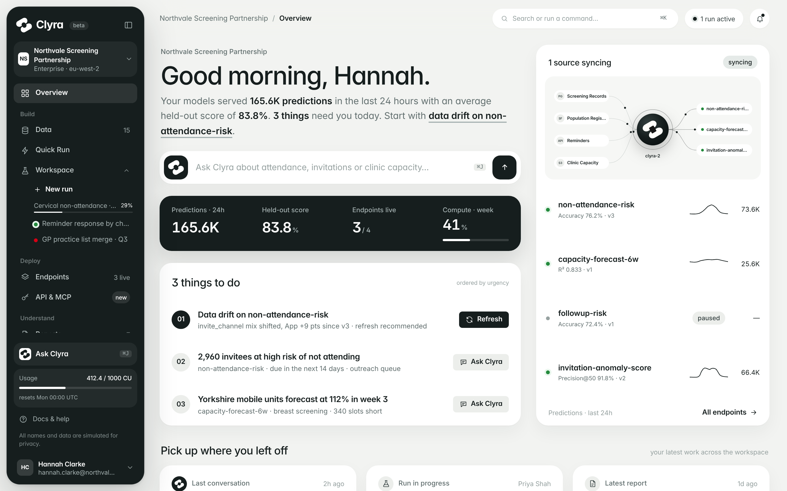
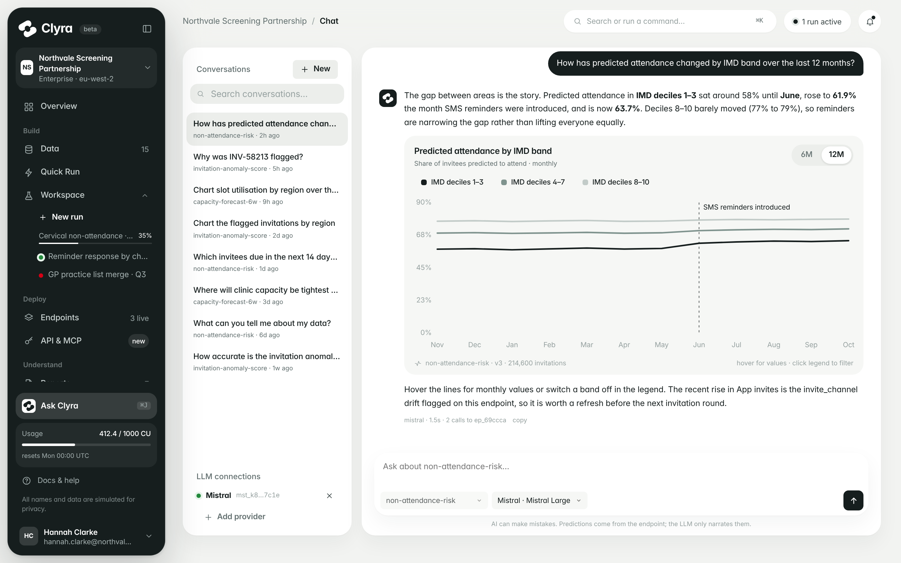
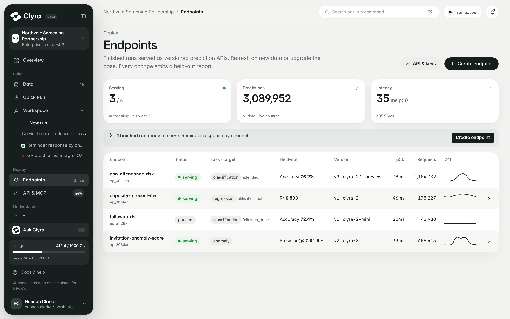

# Clyra

Front-end prototype of **Clyra**, a data-language platform that turns an organisation's tables into prediction endpoints with a tabular foundation model. You connect sources, run a model on them, serve the result as a versioned endpoint and ask questions about it in plain language.

**Live prototype:** https://leonardobressan-99.github.io/clyra/

Design and front end by [Leonardo Bressan](https://www.leonardobressan.com).

> All names and data are simulated for privacy.



## What you can try

- **Overview**: what needs attention today, live endpoints and an "Ask Clyra" box.
- **Data**: connected sources and tables, with column profiles and previews.
- **Quick Run / Workspace**: run the model on one or more tables and watch each stage, from mapping tables without shared keys to the held-out evaluation.
- **Endpoints**: serve a run as an API, refresh it on new data, see drift.
- **Reports**: a ledger of every model change with its held-out metrics.
- **Ask Clyra**: chat with an endpoint, including interactive charts.

Everything runs in the browser. Actions are simulated and state is kept in `localStorage`; "Load demo workspace" in the profile menu restores the demo.

| Ask Clyra | Endpoints |
| --- | --- |
|  |  |

## Run locally

Open `index.html` in a browser. No build step or server is needed.

The app is split into modules in `src/`. `app.js` is those files joined in order:

```sh
cat src/01-core.js src/02-data.js src/03-shell.js src/04-pages.js src/05-overlays.js src/06-actions.js > app.js
```
